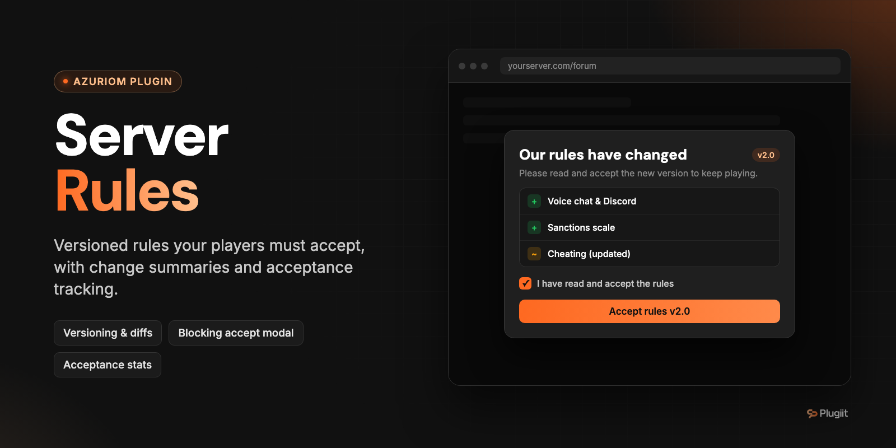

# Plugiit Rules

Versioned server rules for Azuriom, with mandatory acceptance by players and full acceptance tracking.

Azuriom plugin · v1.0.0 · by Plugiit

## Features

- **Rules editing**: the rules are made of ordered sections (drag and drop) edited with the Azuriom rich text editor. Sections form a **draft** that players do not see until it is published.
- **Version publishing**: version number (suggested automatically), summary of the changes, and a "require a new acceptance" option (otherwise the version is a minor fix and players are not asked again). Each version is an immutable snapshot.
- **Automatic change summaries** between versions: added, modified and removed sections. The admin panel also shows the unpublished changes of the draft.
- **Public rules page** at `/plugiit-rules`: current version, table of contents with anchors, the player's acceptance status, and version history with summaries and changes. Older versions are available at `/plugiit-rules/versions/{id}`.
- **Mandatory acceptance** for logged-in players who have not accepted the latest version that requires it:
  - **blocking popup**: the website cannot be used until the player accepts (they can still log out);
  - **non-blocking banner** at the top of the pages (can be hidden for the browsing session);
  - or nothing at all.
- **Action blocking** until the rules are accepted (form submissions only, browsing stays possible): forum, shop, news comments, support, votes, or any named route (wildcards allowed). AJAX/JSON requests get a `403` JSON response.
- **Registration checkbox** (optional): automatically added to the registration form, checked server-side, and the acceptance is recorded when the account is created.
- **Tracking**: share of accounts that accepted the required version, latest acceptances, acceptances per version, per-player search (date, version, source, IP hashed with HMAC-SHA256) and a "Rules" card on the user page of the admin panel.
- **Theme-agnostic**: the popup and banner are injected automatically, no theme change needed.
- Action log entries when a version is published and when the settings are updated.
- English and French translations.

## Requirements

- Azuriom `1.1.0` or later (`azuriom_api` 1.1.0).

## Installation

**From the Azuriom Market** (recommended): install and enable the plugin from **Admin → Plugins**.

**Manually**:

1. Copy the plugin into the `plugins/` directory of your Azuriom installation. The folder **must be named after the plugin ID**, not after the repository:

   ```
   plugins/plugiit-rules/
   ```

2. Enable the plugin from **Admin → Plugins**. The migrations (tables `plugiit_rules_sections`, `plugiit_rules_versions`, `plugiit_rules_acceptances`) run automatically.

Then:

1. **Admin → Rules → Sections (draft)**: write the sections, then **Publish a new version**.
2. **Admin → Rules → Settings**: choose the display mode, the blocked actions and the registration option.
3. Add the "Rules" page to your navbar (**Admin → Navbar**, type "Plugin").

## Configuration

### Permission

| Permission | Description |
| --- | --- |
| `plugiit-rules.admin` | Manage the rules, their versions and view acceptances (requires admin panel access) |

### Admin pages

| Page | URL |
| --- | --- |
| Overview | `/admin/plugiit-rules` |
| Sections (draft) | `/admin/plugiit-rules/sections` |
| Versions | `/admin/plugiit-rules/versions` |
| Acceptances per player | `/admin/plugiit-rules/users` |
| Settings | `/admin/plugiit-rules/settings` |

The overview shows the current version, the version to accept, the share of players who accepted it, the latest acceptances, whether the draft has unpublished changes, the display mode and the blocked actions.

### Settings

| Setting | Default | Description |
| --- | --- | --- |
| Display mode | Blocking popup | `Blocking popup`, `Non-blocking banner` or `Display nothing`, for logged-in players who have not accepted the required version. |
| Block some actions | Off | Block form submissions until the rules are accepted. |
| Blocked groups | none | Forum (`forum.*`), Shop (`shop.*`), News comments (`posts.comments.*`), Support (`support.*`), Votes (`vote.*`). |
| Other routes to block | none | Route names, wildcards allowed (e.g. `wiki.*`, `profile.update`). |
| Require acceptance on registration | Off | Adds a mandatory checkbox to the registration form. |

## Usage

### Public pages

| URL | Description |
| --- | --- |
| `/plugiit-rules` | Current version of the rules. |
| `/plugiit-rules/versions/{id}` | A specific (possibly older) version. |
| `POST /plugiit-rules/accept` | Accept the current version (logged-in players, used by the page and the popup). |

### How the injection works

A middleware appended to the `web` group injects the display: the popup is inserted before `</body>`, the banner right after `<body>`. Injection only happens on `GET` HTML responses with status `200`, outside `admin/*`, `api/*` and AJAX requests. It works with every theme without modification.

The CSS and JS (`assets/css/style.css`, `assets/js/script.js`) only use classes and IDs prefixed with `plugiit-rules-`.

### Theme widget

Shows the acceptance status of the logged-in player, with a link to the rules page:

```blade
@include('plugiit-rules::widget')

{{-- or --}}
@plugiitRulesStatus
```

## Support

Open an issue on GitHub or contact Plugiit.

## Contributing

Issues and pull requests are welcome.

## License

License: to be defined.
